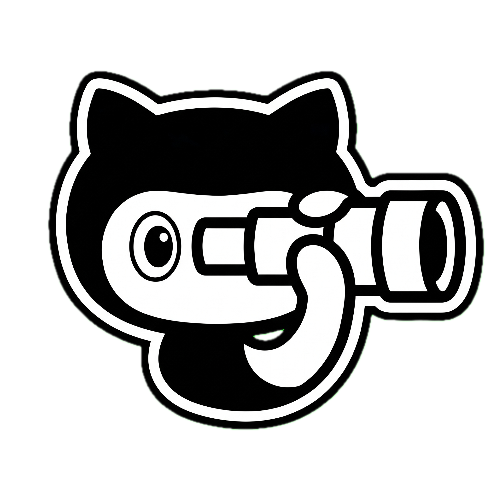
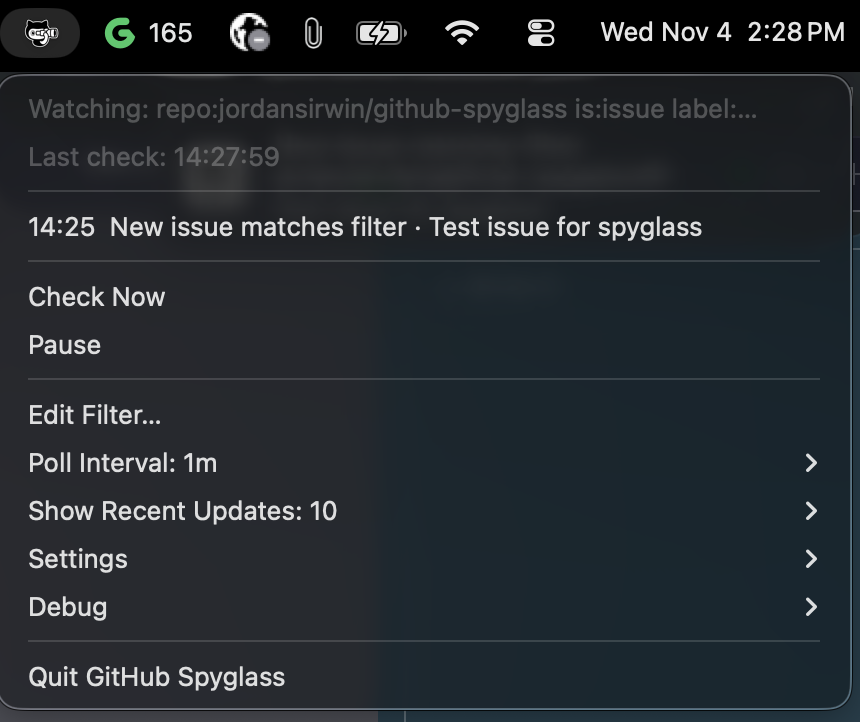
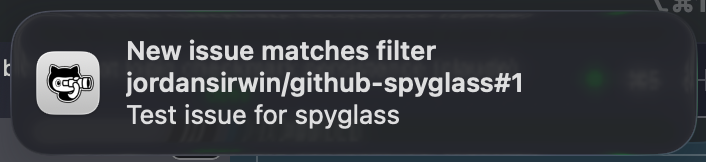

<p align="center">
  
</p>

# github-spyglass

Watches GitHub issues matching a [search filter](https://docs.github.com/en/search-github/searching-on-github/searching-issues-and-pull-requests) and sends macOS notifications when they change — like GitHub notifications, but for an arbitrary filter instead of just things you're subscribed to.

You get notified when a matched issue:

- receives a **new comment** (with the commenter and an excerpt)
- is **closed or reopened**
- is otherwise **edited** (title, body, labels, assignees, ...)
- **newly matches** the filter

## Screenshots

<strong>Menu bar</strong>



<strong>Notification example</strong>



## Menu bar app

```bash
make run-app      # build GitHub Spyglass.app, install to ~/Applications, launch
```

The GitHub Spyglass icon appears in the menu bar. The dropdown shows:

- the filter being watched and the last check time
- the **most recent updates**, timestamped (just the time for today, the date for older ones) — click one to open the issue in your browser
- **Check Now** / **Pause**
- **Edit Filter…** — change the search filter (takes effect immediately; the new
  filter's existing issues are seeded silently)
- **Poll Interval** — pick how often to check (1m–1h, default 5m)
- **Show Recent Updates** — how many updates the dropdown shows (5/10/25/50,
  default 10)
- **Settings** — **Set GitHub Token…** (paste a personal access token; saved to
  `~/.github-spyglass/token`) and **Start at Login** (registers a login item;
  macOS will ask to allow controlling System Events the first time)
- **Debug** — send a test notification, open the log/config/state files or
  the data folder, jump to macOS notification settings

On first launch it prompts for a filter. Settings live in
`~/.github-spyglass/config.json` (query, interval, recent count, optional
token), recent updates in `~/.github-spyglass/events.json` (kept across restarts), logs in `~/.github-spyglass/app.log`. The app has no Dock icon; quit
it from the menu.

Don't run the app and the CLI against the same state file at the same time —
they'd race and double-notify.

## CLI

```bash
make build        # builds ./github-spyglass
make test         # run unit tests
make install      # go install into $GOBIN
```

## Usage

```bash
./github-spyglass -query 'repo:jordansirwin/github-spyglass is:issue is:open label:spyglass' -interval 5m
```

The first run seeds state silently; notifications start on the next poll. State lives in `~/.github-spyglass/state.json`.

Flags:

| Flag | Default | Description |
|---|---|---|
| `-query` | (required) | GitHub search filter. Add `is:issue` to exclude PRs — the search API returns both. |
| `-interval` | `5m` | Poll interval (minimum `1m`). |
| `-state` | `~/.github-spyglass/state.json` | State file path. Use different files to run multiple filters at once. |
| `-token` | auto | GitHub token. Defaults to the token saved by the menu bar app, then `$GITHUB_TOKEN`, `$GH_TOKEN`, then `gh auth token`. |
| `-once` | false | Single poll and exit (useful for cron/launchd). |
| `-verbose` | false | Verbose logging. |

## Notifications

The **menu bar app** posts notifications natively through Notification Center
as GitHub Spyglass — clicking one opens the issue in your browser. Allow
notifications when macOS asks on first launch.

The **CLI** runs outside an app bundle, so it uses
**[terminal-notifier](https://github.com/julienXX/terminal-notifier)**
(`brew install terminal-notifier`) instead, which also supports click-to-open.
If it isn't installed, the CLI falls back to `osascript` (ships with macOS, no
click action).

To make notifications **stick on screen until you clear them**, set the alert
style to **Alerts** once in System Settings → Notifications (under GitHub
Spyglass for the app, or terminal-notifier for the CLI — the entry appears
after the first notification).

## Authentication

A token is strongly recommended: unauthenticated search is limited to 10 requests/minute and can't see private repos. The token is taken from the first of these that is set:

1. the `token` field in `~/.github-spyglass/config.json` (menu bar app) or the `-token` flag (CLI)
2. the token saved by **Settings → Set GitHub Token…** in `~/.github-spyglass/token`
3. `$GITHUB_TOKEN` or `$GH_TOKEN`
4. `gh auth token`, if you use the `gh` CLI

Apps launched from Finder or at login don't see your shell's environment variables, so for the menu bar app use **Set GitHub Token…** (a personal access token with the `repo` scope; authorize it for SSO orgs). A stale `gh` keychain login also breaks the app, since the shell's `GITHUB_TOKEN` isn't visible to it.

## Running in the background

The app loops on its own, so the simplest option is a background shell:

```bash
nohup ./github-spyglass -query '...' >> ~/.github-spyglass/log.txt 2>&1 &
```

For something that survives reboots, create a LaunchAgent at `~/Library/LaunchAgents/com.jirwin.github-spyglass.plist`:

```xml
<?xml version="1.0" encoding="UTF-8"?>
<!DOCTYPE plist PUBLIC "-//Apple//DTD PLIST 1.0//EN" "http://www.apple.com/DTDs/PropertyList-1.0.dtd">
<plist version="1.0">
<dict>
  <key>Label</key><string>com.jirwin.github-spyglass</string>
  <key>ProgramArguments</key>
  <array>
    <string>/path/to/github-spyglass</string>
    <string>-query</string>
    <string>repo:jordansirwin/github-spyglass is:issue is:open label:spyglass</string>
    <string>-interval</string>
    <string>5m</string>
  </array>
  <key>RunAtLoad</key><true/>
  <key>KeepAlive</key><true/>
  <key>StandardOutPath</key><string>/tmp/github-spyglass.log</string>
  <key>StandardErrorPath</key><string>/tmp/github-spyglass.log</string>
</dict>
</plist>
```

Then `launchctl load ~/Library/LaunchAgents/com.jirwin.github-spyglass.plist`.

## License

[MIT](LICENSE). The vendored [`third_party/systray`](third_party/systray) is a
modified copy of [fyne-io/systray](https://github.com/fyne-io/systray) and
keeps its own Apache-2.0 license.
